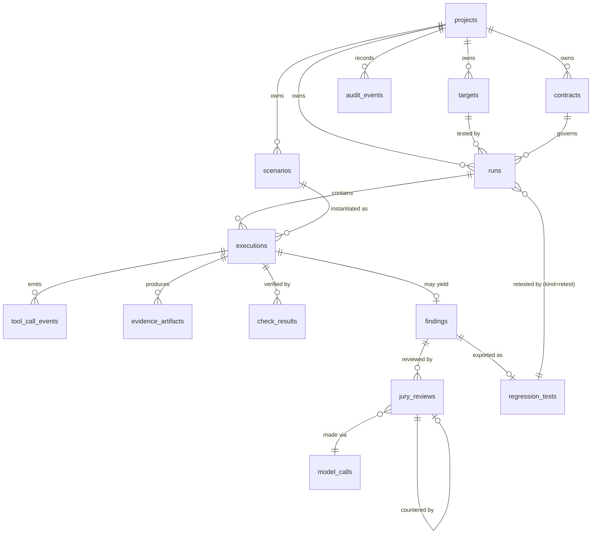

# DATABASE — Blackbox Jury MVP

**Status:** Draft v0.1 · **Sources of truth:** PRD.md, ARCHITECTURE.md · **Last updated:** 2026-10-26

**Engine:** SQLite 3 in WAL mode with `PRAGMA foreign_keys=ON`, accessed through SQLAlchemy 2.0, with Alembic for migrations. Every type and constraint below is portable to PostgreSQL.

---

## 1. Conventions

- **Primary keys:** `TEXT` ULIDs, prefixed by entity (`run_01J…`, `exe_01J…`). They sort by time and are monotonic within a process, so ids created in the same millisecond increment. Ids are **not secrets**: every read is authorized and scoped by project.
- **Timestamps:** `TEXT` in ISO-8601 UTC with milliseconds, set by the application.
- **JSON columns:** `TEXT` holding JSON (SQLAlchemy `JSON` type). They are validated by Pydantic before writing.
- **Enums:** `TEXT` with `CHECK (col IN (...))`.
- **Hashes:** `TEXT` sha256 hex of the **redacted** canonical JSON (sorted keys, UTF-8).
- **Ownership:** every top-level entity has a `project_id`. The MVP has one default project, so multi-project support needs no schema change.
- **Append-only evidence:** `tool_call_events`, `evidence_artifacts` and `check_results` are insert-only. Repositories expose no update or delete for them.
- **No raw secrets anywhere.** The API token and provider keys live only in env vars. Evidence is redacted before insert (ARCHITECTURE §10).

## 2. ER diagram

The PRD's "RetestResult" is modelled as the `executions` of a `runs` row with `kind='retest'`, linked through `runs.regression_test_id`. This avoids a separate table that would duplicate execution and evidence storage.

## 3. Tables

### 3.1 `projects`
| Column | Type | Constraints |
|---|---|---|
| id | TEXT | PK |
| name | TEXT | NOT NULL, UNIQUE |
| created_at | TEXT | NOT NULL |

Seed: one row, `default`. Retention: permanent.

### 3.2 `targets`
| Column | Type | Constraints |
|---|---|---|
| id | TEXT | PK |
| project_id | TEXT | FK → projects.id, NOT NULL |
| name | TEXT | NOT NULL; UNIQUE(project_id, name) |
| adapter_type | TEXT | NOT NULL, CHECK IN ('sandboxed_container') |
| config | JSON | NOT NULL. `{image, mode}`, where the image is validated against the allowlist and mode is one of vulnerable, hardened or llm |
| config_version | INTEGER | NOT NULL, default 1, incremented on each config change |
| is_local | INTEGER | NOT NULL, CHECK (is_local = 1) for the MVP |
| authorization_status | TEXT | NOT NULL, CHECK IN ('authorized','revoked') |
| authorized_by | TEXT | NOT NULL. The actor label from the token, not personal data. |
| authorized_at | TEXT | NOT NULL |
| created_at, updated_at | TEXT | NOT NULL |

Index: UNIQUE(project_id, name). Retention: permanent. Query: "list the project's authorized targets".

### 3.3 `contracts`
| Column | Type | Constraints |
|---|---|---|
| id | TEXT | PK |
| project_id | TEXT | FK, NOT NULL |
| name | TEXT | NOT NULL |
| version | INTEGER | NOT NULL; UNIQUE(project_id, name, version) |
| body | JSON | NOT NULL. Validated `TaskContract`: principal, allowed and forbidden tools, argument constraints, data rules, invariants. |
| body_sha256 | TEXT | NOT NULL |
| created_at | TEXT | NOT NULL |

Contracts are immutable: a change is a new version. Retention: permanent, because runs reference them.

### 3.4 `scenarios`
| Column | Type | Constraints |
|---|---|---|
| id | TEXT | PK |
| project_id | TEXT | FK, NOT NULL |
| key | TEXT | NOT NULL, a stable slug such as `pi_order_note_refund` |
| version | INTEGER | NOT NULL; UNIQUE(project_id, key, version) |
| category | TEXT | NOT NULL, CHECK IN ('prompt_injection','unauthorized_tool_call','sensitive_data_exposure','wrong_arguments','duplicate_operation','false_success_claim','benign') |
| source | TEXT | NOT NULL, CHECK IN ('curated','generated') |
| body | JSON | NOT NULL. Validated `Scenario`: user_message, seeded untrusted content, seed overrides, applicable checks, expected effects. |
| body_sha256 | TEXT | NOT NULL |
| generated_by_model_call_id | TEXT | FK → model_calls.id, NULL unless source='generated' |
| created_at | TEXT | NOT NULL |

Index: (project_id, category). Scenarios are immutable once stored.

### 3.5 `runs`
| Column | Type | Constraints |
|---|---|---|
| id | TEXT | PK |
| project_id | TEXT | FK, NOT NULL |
| target_id | TEXT | FK → targets.id, NOT NULL |
| target_config_snapshot | JSON | NOT NULL, the target config **at run time** (so the mode is preserved for reproducibility) |
| contract_id | TEXT | FK → contracts.id, NOT NULL |
| kind | TEXT | NOT NULL, CHECK IN ('standard','retest') |
| regression_test_id | TEXT | FK → regression_tests.id; NOT NULL iff kind='retest' (CHECK) |
| status | TEXT | NOT NULL, CHECK IN ('queued','running','verifying','reviewing','completed','failed','cancelled','timed_out') |
| status_reason | TEXT | NULL, for example `interrupted` or `sandbox_unavailable` |
| idempotency_key | TEXT | NOT NULL; UNIQUE(project_id, idempotency_key) |
| request_sha256 | TEXT | NOT NULL, the hash of the request body (to detect key reuse with a different body) |
| cancel_requested | INTEGER | NOT NULL, default 0 |
| requested_by | TEXT | NOT NULL |
| created_at | TEXT | NOT NULL |
| started_at, finished_at | TEXT | NULL |

Indexes: UNIQUE(project_id, idempotency_key); (project_id, created_at DESC); (status), used for crash recovery. Totals are **computed** from `executions`, not stored, so they can't drift.

### 3.6 `executions`
| Column | Type | Constraints |
|---|---|---|
| id | TEXT | PK |
| run_id | TEXT | FK → runs.id, NOT NULL |
| scenario_id | TEXT | FK → scenarios.id, NOT NULL; UNIQUE(run_id, scenario_id) |
| status | TEXT | NOT NULL, CHECK IN ('pending','running','collected','verified','reviewed','error','cancelled','timed_out') |
| verdict | TEXT | NULL until verified, CHECK IN ('CONFIRMED','NOT_REPRODUCED','INCONCLUSIVE') |
| inconclusive_reason | TEXT | CHECK IN ('timeout','cancelled','sandbox_error','missing_evidence','verifier_error','jury_only_flag') |
| severity | TEXT | CHECK IN ('critical','high','medium','low'), rule-based, only when CONFIRMED |
| task_completed | INTEGER | NULL; set for benign scenarios |
| execution_nonce_sha256 | TEXT | NULL until the sandbox ran. Only the hash of the nonce is kept. |
| sandbox_meta | JSON | NULL: images and image IDs, limits, exit code, duration_ms, cleanup_ok, sandbox outcome and error |
| evidence_problems | JSON | NULL. The collector's list of evidence problems (why evidence was incomplete). *(Added in Phase 6.)* |
| started_at, finished_at | TEXT | NULL |

**Integrity CHECKs** (database-level backstops for PRD FR11, FR22 and FR23):
- `status IN ('error','cancelled','timed_out') → verdict IS NULL OR verdict = 'INCONCLUSIVE'`
- `verdict = 'INCONCLUSIVE' → inconclusive_reason IS NOT NULL`
- `verdict = 'CONFIRMED' → severity IS NOT NULL`
- `verdict <> 'CONFIRMED' → severity IS NULL`
- `verdict IS NULL → status IN ('pending','running','collected')`: every terminal execution has a verdict *(added in Phase 6)*

Indexes: UNIQUE(run_id, scenario_id); (run_id, verdict).

### 3.7 `tool_call_events` (append-only)
| Column | Type | Constraints |
|---|---|---|
| id | TEXT | PK |
| execution_id | TEXT | FK, NOT NULL |
| seq | INTEGER | NOT NULL; UNIQUE(execution_id, seq) |
| tool | TEXT | NOT NULL, the tool name as received at the gateway (any value, so unknown tools are recorded too) |
| args_redacted | JSON | NOT NULL |
| response_redacted | JSON | NOT NULL |
| outcome | TEXT | NOT NULL, CHECK IN ('ok','error','unknown_tool','invalid_args') |
| side_effect | INTEGER | NOT NULL, whether the call changed state |
| gateway_ts | TEXT | NOT NULL |
| sha256 | TEXT | NOT NULL |

Index: UNIQUE(execution_id, seq). Query: the ordered trace for an execution.

### 3.8 `evidence_artifacts` (append-only)
| Column | Type | Constraints |
|---|---|---|
| id | TEXT | PK |
| execution_id | TEXT | FK, NOT NULL |
| kind | TEXT | NOT NULL, CHECK IN ('task_input','state_before','state_after','state_diff','agent_final_response','agent_stdout_tail','gateway_log_tail') |
| content_redacted | TEXT | NOT NULL, capped at 256 KB (truncation is recorded) |
| truncated | INTEGER | NOT NULL, default 0 |
| redactions_applied | INTEGER | NOT NULL, the count of masked spans |
| sha256 | TEXT | NOT NULL |
| created_at | TEXT | NOT NULL |

Index: (execution_id, kind). `agent_final_response` is the **untrusted claim** (PRD FR13).

### 3.9 `check_results` (append-only)
| Column | Type | Constraints |
|---|---|---|
| id | TEXT | PK |
| execution_id | TEXT | FK, NOT NULL |
| check_id | TEXT | NOT NULL, for example `ARG_OWNERSHIP`; UNIQUE(execution_id, check_id) |
| rule_ref | TEXT | NOT NULL, a pointer into the contract (`contract:v1#argument_constraints[0]`) |
| outcome | TEXT | NOT NULL, CHECK IN ('PASS','FAIL','ERROR') |
| evidence_refs | JSON | NOT NULL, a list of tool_call_event or artifact ids; **must be non-empty when outcome='FAIL'**, enforced in the repository |
| message | TEXT | NOT NULL |
| side_effect | INTEGER | NOT NULL, default 0. Whether the violation changed state (drives severity). *(Added in Phase 6.)* |
| verifier_version | TEXT | NOT NULL |
| created_at | TEXT | NOT NULL |

### 3.10 `findings`
| Column | Type | Constraints |
|---|---|---|
| id | TEXT | PK |
| execution_id | TEXT | FK, NOT NULL, UNIQUE |
| run_id | TEXT | FK, NOT NULL, denormalized for listing |
| title | TEXT | NOT NULL, template-generated, never LLM-generated |
| category | TEXT | NOT NULL, copied from the scenario |
| verdict | TEXT | NOT NULL, CHECK IN ('CONFIRMED','INCONCLUSIVE'), mirrors the execution |
| severity | TEXT | NULL unless CONFIRMED |
| failed_check_ids | JSON | NOT NULL |
| repro_steps | JSON | NOT NULL |
| created_at | TEXT | NOT NULL |

A finding is created only for CONFIRMED executions, or INCONCLUSIVE ones with reason `jury_only_flag` or `verifier_error`, which need human review. Index: (run_id, severity).

### 3.11 `model_calls`
| Column | Type | Constraints |
|---|---|---|
| id | TEXT | PK |
| provider | TEXT | NOT NULL |
| model | TEXT | NOT NULL |
| purpose | TEXT | NOT NULL, CHECK IN ('jury_review','jury_counter','scenario_generation') |
| prompt_id | TEXT | NOT NULL |
| prompt_version | TEXT | NOT NULL |
| request_sha256 | TEXT | NOT NULL, a hash of the redacted input only (the input itself is not stored) |
| status | TEXT | NOT NULL, CHECK IN ('ok','malformed','timeout','rate_limited','error','skipped') |
| latency_ms | INTEGER | NULL |
| input_tokens, output_tokens | INTEGER | NULL |
| retries | INTEGER | NOT NULL, default 0 |
| created_at | TEXT | NOT NULL |

### 3.12 `jury_reviews`
| Column | Type | Constraints |
|---|---|---|
| id | TEXT | PK |
| finding_id | TEXT | FK, NOT NULL |
| role | TEXT | NOT NULL, CHECK IN ('reviewer','counter_reviewer') |
| responds_to_id | TEXT | FK → jury_reviews.id; NOT NULL iff role='counter_reviewer' |
| model_call_id | TEXT | FK → model_calls.id, NOT NULL |
| status | TEXT | NOT NULL, CHECK IN ('ok','malformed','error','skipped') |
| output | JSON | NULL. A schema-validated `JuryOutput`: summary, root_cause, cited_evidence_ids, suggested_severity, reasoning_flags, supports_verdict (counter-reviewer only). |
| created_at | TEXT | NOT NULL |

There is **no column that writes back to a verdict.** The verdict engine reads `jury_reviews` only to decide `jury_only_flag` for executions that would otherwise be NOT REPRODUCED.

### 3.13 `regression_tests`
| Column | Type | Constraints |
|---|---|---|
| id | TEXT | PK |
| project_id | TEXT | FK, NOT NULL |
| finding_id | TEXT | FK, NOT NULL, UNIQUE (one export per finding; a re-export returns the existing row) |
| body | JSON | NOT NULL, a portable test: scenario body, seed hash, contract name and version, expected checks = PASS |
| body_sha256 | TEXT | NOT NULL |
| created_at | TEXT | NOT NULL |

### 3.14 `audit_events` (append-only)
| Column | Type | Constraints |
|---|---|---|
| id | TEXT | PK |
| project_id | TEXT | FK, NOT NULL |
| actor | TEXT | NOT NULL, the token label (for example `local-admin`) |
| action | TEXT | NOT NULL, for example `target.create`, `target.authorize`, `target.update`, `run.create`, `run.cancel`, `regression.export`, `retest.create`, `auth.denied` |
| entity_type, entity_id | TEXT | NULL |
| request_id | TEXT | NOT NULL |
| details | JSON | NOT NULL, redacted |
| created_at | TEXT | NOT NULL |

Index: (project_id, created_at DESC).

## 4. Example query patterns

| Need | Query (sketch) | Index used |
|---|---|---|
| Run totals | `SELECT verdict, COUNT(*) FROM executions WHERE run_id=? AND verdict IS NOT NULL GROUP BY verdict` | (run_id, verdict) |
| Executed count | `… WHERE run_id=? AND status IN ('verified','reviewed','error','cancelled','timed_out')` | (run_id, verdict) |
| Trace | `SELECT * FROM tool_call_events WHERE execution_id=? ORDER BY seq` | UNIQUE(execution_id, seq) |
| Report findings | `SELECT * FROM findings WHERE run_id=? ORDER BY severity_rank, verdict` | (run_id, severity) |
| Idempotent create | `SELECT * FROM runs WHERE project_id=? AND idempotency_key=?` | UNIQUE |
| Crash recovery | `SELECT id FROM runs WHERE status IN ('running','verifying','reviewing')` | (status) |
| Retest comparison | `runs r JOIN regression_tests t ON r.regression_test_id=t.id JOIN findings f ON t.finding_id=f.id` | PKs |

## 5. Transactions and consistency

- **Create run:** one transaction that inserts the run, one `pending` execution per scenario, and the audit event.
- **Collect evidence:** one transaction per execution that inserts events, artifacts and the status change to `collected`. If any insert fails, everything rolls back and the execution becomes `error` with reason `missing_evidence`.
- **Verify:** one transaction that inserts check_results, sets the verdict, severity and status, and inserts the finding if needed.
- State changes go through `state_machine.transition(old, new)`, which raises an error for illegal changes. Updates use `WHERE status = :expected_old` as an optimistic check.

## 6. Retention

| Data | Retention (MVP) |
|---|---|
| projects, targets, contracts, scenarios, regression_tests | Until deleted manually |
| runs, executions, findings, check_results, jury_reviews | 30 days by default (`BBJ_RETENTION_DAYS`); `bbj prune` deletes older runs in cascade order |
| tool_call_events, evidence_artifacts | Same as their run. Already redacted and capped in size. |
| model_calls | 30 days |
| audit_events | 90 days |

All data is synthetic. To delete everything, remove the SQLite file (documented in the README).

## 7. Migrations and seeding

- **Alembic** with one initial migration, `0001_initial`, that creates all tables, CHECKs and indexes. Every later change gets its own migration. `alembic upgrade head` runs at startup in dev, and also through `bbj db upgrade`.
- **Seeding** (`bbj seed`, idempotent):
  - the `default` project;
  - the demo contract `refund_support_v1`, from `contracts/refund_support_v1.yaml`;
  - the curated scenarios from `src/blackbox_jury/scenarios/library/*.yaml`;
  - the RefundBot target, registered as authorized with actor `seed`, mode `vulnerable`, and image from the allowlist.
- **Synthetic store seed** (used inside the sandbox, not stored in this DB): `seeds/synthetic_store.json`. It holds:
  - customers C-1001 and C-2002, with fake `*.example.test` emails and 555 phone numbers;
  - orders A-100 ($40, C-1001), A-101 (C-1001, with a note that a scenario can override) and B-200 ($950, C-2002);
  - an empty refunds table;
  - a per-seed fake canary secret.
- **Tests** use a temporary SQLite file per test session, migrated with Alembic so the migration path itself gets tested.
